# Implementation Plan: BhoomiIQ Standalone Satellite Crop Intelligence & Farmer Portal

A scientifically grounded, standalone agricultural web application and farm advisory system that bridges multispectral Earth observation (Copernicus Sentinel-2, Bhuvan, IMD Weather) with real-world sugar factory operations, parcel-level crop analytics, harvesting slips, and agronomic guidance.

---

## 1. Goal Description & Background Context

The user request addresses a fundamental challenge in digital agriculture: **distinguishing visual satellite imagery from validated agricultural science**.

In many agricultural prototypes (as observed in the initial BhoomiIQ screenshots):
1. Ordinary visual RGB imagery (e.g., Google Satellite map tiles) is frequently conflated with multispectral remote sensing.
2. Canopy moisture signals (NDMI) are mistakenly presented as direct root-zone soil moisture.
3. Small parcels (0.59 – 1.08 acres) suffer from boundary contamination and coarse pixel resolution (~6 to 24 pixels per plot under 10m/20m Sentinel-2 bands).
4. Timestamp, scene ID, cloud mask, and image freshness are obscured.
5. Farmer recommendations default to generic boilerplate ("Check the field before deciding") instead of evidence-backed, field-calibrated insights.

### Purpose of this Plan
This plan defines the full specification, system architecture, data models, agronomic calculation pipelines, and UI design for a **production-ready, standalone Web Application** for the **BhoomiIQ Farmer Portal & Crop Intelligence Platform**. It maintains the familiar, farmer-friendly green/white design system seen in the factory screenshots while upgrading the computational backbone to rigorous remote-sensing and agronomic standards.

### What BhoomiIQ Does — Main Website Functions

BhoomiIQ is a standalone farmer portal for satellite-based crop monitoring and sugar-factory services. Its main working is to connect a farmer's registered field boundary with satellite observations, weather information, agricultural records, and practical next steps. The intended workflow is:

1. **Register and select fields:** Display each registered farm plot, its mapped boundary, area, sugarcane variety, planting date, and crop stage.
2. **Retrieve earth-observation and weather data:** Find suitable Sentinel-2 multispectral imagery and relevant weather/rainfall information for the field and date. Bhuvan and other approved sources may be used where suitable data and access are available.
3. **Process satellite imagery:** Mask clouds and shadows, check data quality, clip imagery to the field polygon, and calculate indices such as NDVI for vegetation greenness and NDMI for a canopy moisture-related signal.
4. **Map field variation:** Display the analytical layer over a visual satellite basemap, show the date and source of the data, and identify usable-pixel limitations—especially for small plots.
5. **Compare observations over time:** Track changes in crop indicators and consider rainfall, evapotranspiration, crop stage, soil information, and field history.
6. **Generate cautious field advisories:** Explain what the data suggests, which part of the field needs attention, possible explanations, confidence/limitations, and what the farmer should verify in person. Do not claim that satellite indices alone confirm root-zone soil moisture, a specific disease, or an exact fertilizer requirement.
7. **Support farmer services:** Provide an AI text/photo assistance interface, crop-stage learning guides, factory schemes and facilities, soil-testing and drone-service requests, and farm-store links.
8. **Manage harvesting records:** Show registrations and harvesting slips, estimated tonnage, status, printable details, and secure QR-based verification. Actual cane delivery and payment must remain distinct from estimates and authorization slips.
9. **Show alerts and history:** Surface field alerts, imagery history, data freshness, and service/record status so farmers can understand what is new and what action is needed.

**Important implementation boundary:** This document is an implementation plan, not proof that all features are already built or connected to live data. The project structure currently includes mock data files; live satellite/weather integrations, AI models, service booking, and secure QR verification must be implemented and tested before those features are described as operational.

```
+---------------------------------------------------------------------------------------------------------+
|                                        BHOOMIIQ SYSTEM ARCHITECTURE                                     |
+---------------------------------------------------------------------------------------------------------+
| [Government & Open Data]                                                                                |
| - Copernicus Data Space (Sentinel-2 L2A: B2, B3, B4, B8, B11, B12, SCL)                                 |
| - IMD / Open-Meteo Agro-Weather (Daily Rainfall, Temp, RH, ET0, 7-Day Forecast)                         |
| - Soil & Agronomy Baseline (Soil type, Co 86032 / Phule 265 sugarcane growth stages)                    |
+---------------------------------------------------+-----------------------------------------------------+
                                                    |
                                                    v
+---------------------------------------------------------------------------------------------------------+
| [Scientific Processing & Indicator Engine]                                                              |
| - Cloud & Shadow Masking (Scene Classification Layer - SCL)                                              |
| - Parcel Geometry Clipping & Sub-pixel Buffer Exclusion (Avoid road/tree edge contamination)            |
| - Spectral Indices: NDVI (Canopy vigor), NDMI (Canopy water signal), NDRE (Nitrogen/Chlorophyll)         |
| - Usable Pixel & Confidence Scoring: Usable Count, Ground Sampling Distance vs Acreage Ratio            |
| - Temporal Trend & Anomaly Engine: Compare vs field historical z-scores & crop stage norm               |
+---------------------------------------------------+-----------------------------------------------------+
                                                    |
                                                    v
+---------------------------------------------------------------------------------------------------------+
| [BhoomiIQ Standalone Web Portal Frontend]                                                               |
| 1. Home Dashboard: Live field summary, alerts, quick actions, factory shortcuts                         |
| 2. Interactive Field Explorer: Dual-layer map (Google Satellite basemap + Sentinel-2 raster overlay),    |
|    pixel inspection, crop growth (NDVI) & moisture signals (NDMI), full metadata audit trail            |
| 3. Sugarcane Harvesting Slips: Authorized registration, tonnage estimation, QR verification             |
| 4. Learn & Factory Schemes: Stage-based crop guides, factory subsidies, deduplicated service directory  |
| 5. "Ask BhoomiIQ" AI Farm Advisor: Evidence-based differential diagnosis, photo triage, WhatsApp action  |
+---------------------------------------------------------------------------------------------------------+
```

---

## 2. User Review Required

> [!IMPORTANT]
> **Standalone Web Architecture Confirmation**:
> As specified in the user request, this is a **standalone web application** (`standalone-bhoomiiq-web`), completely independent of the existing mobile attendance project in the workspace. It will be built using a modern frontend stack (React + Vite + TypeScript + TailwindCSS / Lucide Icons + Leaflet/Canvas geospatial rendering).

> [!WARNING]
> **Scientific Integrity & Nomenclature Boundary**:
> The portal will strictly enforce truthful terminology:
> - The map background is labeled **"Visual Basemap (Google Satellite)"**.
> - The analytical raster is labeled **"Sentinel-2 Surface Reflectance (L2A)"** with explicit band combinations (`B8 - NIR`, `B4 - Red`, `B11 - SWIR`).
> - The moisture tab is explicitly labeled **"Canopy Moisture Signal (NDMI)"** with a bold advisory: *"Measures canopy water stress. For root-zone soil moisture, combine with IMD rainfall and soil-testing data."*

> [!NOTE]
> **Handling Small Plot Resolution (0.59 to 1.08 Acres)**:
> In a 0.59-acre plot, Sentinel-2 10m pixels yield ~24 raw pixels, and 20m SWIR pixels yield only ~6 raw pixels. A 5-meter inner buffer is applied to avoid boundary contamination (roads, canal, trees). The UI will prominently display:
> - **Usable Pure Pixels Count** (e.g., `18 pure pixels of 24`).
> - **Confidence Index** (`Medium - Small Parcel Alert`).
> - **Drone/Sensor Upgrade CTA** (`Book factory multispectral drone for sub-decimeter resolution`).

---

## 3. Core Problems & Engineering Solutions

### Problem 1: Visual RGB vs. Scientific Multispectral Data
* **Existing Flaw**: Visual RGB aerial images cannot measure chlorophyll absorption or internal mesophyll cellular water content.
* **Solution**: 
  - Dual-layer geospatial rendering engine: Leaflet/MapLibre loads Google Satellite or Esri World Imagery as the high-res visual reference basemap ($<0.5\text{m}$ visual detail).
  - Sentinel-2 Level-2A surface reflectance data is fetched via Copernicus Data Space / Sentinel Hub / STAC API.
  - Normalized Difference Vegetation Index:
    $$\text{NDVI} = \frac{B8 (\text{NIR}) - B4 (\text{Red})}{B8 (\text{NIR}) + B4 (\text{Red})}$$
  - Normalized Difference Moisture Index:
    $$\text{NDMI} = \frac{B8 (\text{NIR}) - B11 (\text{SWIR})}{B8 (\text{NIR}) + B11 (\text{SWIR})}$$
  - Renders indexed raster matrices clipped strictly to the GeoJSON parcel boundary with smooth SVG/Canvas colormap interpolation.

### Problem 2: Canopy Moisture Signal vs. Root-Zone Soil Moisture
* **Existing Flaw**: A lower NDMI does not necessarily mean dry soil; it may indicate immature foliage, disease, root rots, or recent cutting.
* **Solution**: 
  - Multi-source Water Stress Index (WSI) synthesizing:
    1. Spectral Canopy Moisture ($\text{NDMI}_{t}$ vs $\text{NDMI}_{\text{baseline}}$).
    2. Atmospheric Water Balance: Recent 14-day cumulative rainfall ($\text{IMD}$) minus Reference Evapotranspiration ($ET_0$).
    3. Soil Texture Water Holding Capacity (e.g., Medium Black Clay / Regur soil with high moisture retention).
    4. Sugarcane Crop Growth Stage (Germination $\rightarrow$ Tillering $\rightarrow$ Grand Growth $\rightarrow$ Maturity).
  - Explicit UI disclaimer: *"Signal indicates leaf hydration state. Inspect soil moisture by physical auger or link factory soil moisture probe before irrigating."*

### Problem 3: Small Parcels Relative to Satellite Pixels
* **Existing Flaw**: 0.59 acres = $2,387\text{ m}^2$. A $10\text{m} \times 10\text{m}$ pixel is $100\text{ m}^2$. Boundary pixels blend border paths, trees, and neighboring crops.
* **Solution**:
  - Topological boundary erosion (negative polygon buffer $-3\text{m}$ to $-5\text{m}$) calculates "Core Parcel Statistics".
  - Pixel Quality Metric card: Displays total pixels, boundary mixed pixels, and interior pure pixels.
  - If pure pixel count $<10$, trigger an automated **Resolution Advisory**: *"Plot size is near satellite spatial limit. Within-field variability is indicative. Recommend factory drone survey for precision zoning."*

### Problem 4: Image Freshness, Cloud Quality & Provenance
* **Existing Flaw**: Displaying "20 Oct" without year, time, cloud cover %, or scene reliability.
* **Solution**:
  - Full provenance badge on every map view:
    - **Acquisition Timestamp**: `2026-10-20 10:42:15 IST (UTC+5:30)`
    - **Sensor Platform**: `Sentinel-2B (MSI Level-2A)`
    - **Tile / Scene ID**: `S2B_MSIL2A_20261020T051829_N0500_R019_T43QDA`
    - **Scene Cloud Cover**: `2.4% (Parcel cloud score: 0.0%)`
    - **Atmospheric Quality**: `Aerosol Optical Thickness: 0.14 - Valid`
  - Integrated "Image History & Timeline" slider allowing farmers to toggle between previous revisit dates (e.g., Oct 15, Oct 10, Oct 05, Sep 30) to see true temporal growth trajectories.

### Problem 5: Evidence-Based Dynamic Recommendations
* **Existing Flaw**: Boilerplate "Check the field before deciding" rendered uniformly across healthy and stressed plots.
* **Solution**:
  - Rule-based & ML Expert System delivering differential diagnosis based on 4 variables:
    1. Spatial distribution of stress (Uniform vs Patchy vs Edge-concentrated).
    2. Temporal delta ($\Delta \text{NDVI} = \text{NDVI}_{\text{current}} - \text{NDVI}_{t-1}$).
    3. Weather context (Recent dry spell vs waterlogging rain).
    4. Sugar factory agronomy calendar (Crop variety Co 86032, Planting Date, Target Harvest Date).
  - Structured Advisory Format:
    - **Observation**: *"0.18 acres in North-West sector shows a 22% drop in NDVI over 15 days."*
    - **Differential Possibilities**: *"1. Stem borer infestation (common in 4-6 month cane); 2. Drip lateral clogging in row 12-18; 3. Salinity patch."*
    - **Recommended Action**: *"1. Physically check cane whorls for dead-hearts; 2. Inspect drip line flush valves; 3. Tap 'Book Drone Survey' or call Field Officer (D. B. Patil - Ph: 98220xxxxx)."*

---

## 4. Comprehensive Portal Screen Architecture

The BhoomiIQ standalone web portal is structured into 5 cohesive modules matching the factory ecosystem:

```mermaid
graph TD
    A[BhoomiIQ Home Dashboard] --> B[Field Intelligence / My Fields]
    A --> C[Sugarcane Harvesting Slips]
    A --> D[Learn & Farm Academy]
    A --> E[Sugar Factory Services & Store]
    A --> F[Ask BhoomiIQ AI Assistant]

    B --> B1[Crop Growth Tab - NDVI Analysis]
    B --> B2[Moisture Signs Tab - NDMI Water Signal]
    B --> B3[Satellite Provenance & Timeline History]
    B --> B4[Dynamic Field Advisory Engine]

    C --> C1[Active Harvest Slips CR-00000002]
    C --> C2[Detailed Printable Slip SC-00000002 with Verified QR]
    C --> C3[Weighbridge & Yield Reconciliation Flow]

    D --> D1[Crop Stage Guides: Planting to Post-Harvest]
    D --> D2[Factory Subsidy Schemes: Drip & Subsurface Drainage]
    D --> D3[Variety Profiles: Co 86032 Adsali vs Suru]

    E --> E1[Multispectral Drone Booking]
    E --> E2[Soil & Water Testing Center]
    E --> E3[Factory Farm Store: Bio-fertilizers & Inputs]

    F --> F1[Photo Diagnosis Leaf Disease Triage]
    F --> F2[Audio/Text Chat in Marathi & English]
```



### Screen 1: Home Dashboard (`/dashboard`)
* **Header**: "Good morning, कारखाना" (Bilingual Marathi/English toggle, Notification Bell with active field alerts, Factory Officer hotline).
* **Hero Widget - "Your Field Today"**:
  - Field Dropdown Selector (`कारखाना बेणे मळा नं.1 - Plot 30 (0.59 ac)`, `कारखाना बेणे मळा नं. 2 - Plot 5 (1.08 ac)`).
  - Interactive Mini-Map with parcel boundary and colored health overlay.
  - Quick Health Status Indicator (Green: Growing well, Yellow: Check, Red: Inspect first).
  - Priority Action Card: Dynamic alert with quick link to deep field inspection.
* **Quick Action Hub**:
  - `My Slips`: Active harvest authorizations and estimated tonnage.
  - `Farm Visits`: Scheduled field inspections by factory cane inspectors.
  - `Farm Store`: Factory-subsidized fertilizers, press mud, and micronutrients.
  - `Drone Services`: Multispectral health mapping & precision ULV spraying.
* **Integrated "Ask BhoomiIQ" Bar**: Fast voice/text prompt input, photo attachment for leaf spot/pest analysis.

### Screen 2: Field Details & Satellite Analytics (`/fields/:id`)
* **Top Navigation & Field Specs**:
  - Plot Name, Survey Number, Registered Area (acres & gunthas), Sugarcane Variety (`Co 86032`), Planting Date, Crop Age (`258 days - Grand Growth`).
* **Dual Analysis Mode Tabs**:
  - **Tab A: Crop Growth (NDVI/EVI)**:
    - 5-class color palette: Dark Green (Healthy/Dense), Light Green (Adequate), Yellow (Moderate/Check), Orange (Stressed), Deep Red (Bare Soil / Severe Stress).
    - Pixel-by-pixel interactive hover tooltip displaying individual pixel NDVI values (e.g., `0.78 - Dense Canopy`).
  - **Tab B: Moisture Signs (NDMI)**:
    - Color scale: Teal/Blue (Wetter signal), Yellow (Middle range), Red/Orange (Drier signal).
    - Water Balance summary: 7-day rainfall vs evapotranspiration.
* **Satellite Quality & Provenance Card**:
  - Acquisition Date & Time, Cloud Cover %, Usable Pixel Count vs Total Pixel Count, Sensor Name (`Sentinel-2B L2A`).
  - **Revisit Timeline Slider**: Interactive date scrubber (Oct 20, Oct 15, Oct 10, Oct 05, Sep 30) demonstrating change detection.
* **"Your Next Step" Dynamic Advisory Card**:
  - Tailored to current plot NDVI/NDMI distribution.
  - Specific GPS sector breakdown (e.g., "North-East corner shows localized stress").
  - Practical checklist before applying chemicals or watering.
  - Action buttons: "Ask BhoomiIQ", "Upload Field Photo", "Link Soil Test", "Book Drone Survey".

### Screen 3: Sugarcane Harvesting Slips (`/slips`)
* **Slip Management List**:
  - Active season filter (`2026-27`).
  - Slip Card summary: Registration ID (`CR-00000002`), Plot Name, Status badge (`Slip issued`), Estimated Cane (`14 tonnes`), Harvest Window (`2 Feb 2027`).
* **Detailed Sugarcane Harvesting Slip View (`/slips/:id`)**:
  - Factory Header: Official Cooperative Sugar Factory crest & branding.
  - Unique Slip ID (`SC-00000002`) & Registration ID (`CR-00000002`).
  - Farmer Details, Village (`राजारामनगर`), Cane Type (`Plant cane`), Variety (`Co 86032`).
  - Planting Date (`2 Feb 2026`) & Target Harvest Date (`2 Feb 2027`).
  - **Secure Dynamic QR Code**: Encodes cryptographically signed verification payload (`{slipId, farmerId, plotId, issuedAt, expTonnage}`).
  - Assigned Slip Boy / Cane Inspector (`Factory Admin / D. B. Patil`).
  - **Legal Factory Disclaimers**: Explicit statement that slip is for harvest authorization only, not a final weighbridge receipt or financial settlement.

### Screen 4: Learn & Factory Knowledge Base (`/learn`)
* **Three Structured Sub-tabs**:
  - **Guides**: Categorized by sugarcane crop stages (Before Planting, Planting, 2 Days After Planting, 10 Days After Harvest, Trash Mulching, Variety Guidance).
    - Verified agronomic dosages (e.g., Bavistin seed treatment, Single Super Phosphate, Urea schedule).
    - Adsali (18-month) vs Suru (12-month) vs Pre-seasonal management.
  - **Schemes**:
    - Deduplicated database of factory programs.
    - *Drip Irrigation Subsidy Scheme* (10% factory top-up over MahaDBT + ₹5,000/acre).
    - *Subsurface Drainage Loan Scheme* (Interest-free loan of ₹4,000/acre for saline/alkali reclamation).
    - Clear eligibility criteria, required documents, and Direct Dial Factory Liaison.
  - **Facilities**:
    - *Multispectral Drone Camera Survey* (Agriculture Dept).
    - *Comprehensive Soil & Water Testing Laboratory* (NPK, Organic Carbon, pH, Electrical Conductivity, Zinc/Iron micronutrients).
    - *Precision Drone Spraying Fleet* (Subsidized spray charges).

### Screen 5: "Ask BhoomiIQ" AI Farm Companion (`/assistant`)
* Multilingual Sugarcane Specialist conversational interface (Marathi & English).
* Capabilities:
  - **Leaf Photo Symptom Triage**: Analyzes user-uploaded photos for Red Rot, Wilt, Early Shoot Borer, White Grub, Pokkah Boeng, or Iron Chlorosis.
  - **Weather-Aware Irrigation Advisory**: Advises whether to irrigate based on upcoming IMD rain forecasts and satellite NDMI readings.
  - **Factory Service Integration**: Directly creates service requests (Soil test kit pickup, drone survey booking) within the chat dialog.

---

## 5. Agronomic & Remote-Sensing Calculations Engine

The frontend calculation and data representation engine incorporates real sugarcane remote-sensing mathematics:

```typescript
// Core Spectral Index Formulas & Usability Scoring
export interface PixelBandData {
  b2_blue: number;    // 490 nm (10m)
  b3_green: number;   // 560 nm (10m)
  b4_red: number;     // 665 nm (10m)
  b8_nir: number;     // 842 nm (10m)
  b11_swir: number;   // 1610 nm (20m)
  scl_class: number;  // Scene Classification Layer (0-11)
}

// 1. NDVI (Crop Growth & Canopy Greenness)
export function calculateNDVI(b8: number, b4: number): number {
  if (b8 + b4 === 0) return 0;
  return (b8 - b4) / (b8 + b4);
}

// 2. NDMI (Normalized Difference Moisture Index)
export function calculateNDMI(b8: number, b11: number): number {
  if (b8 + b11 === 0) return 0;
  return (b8 - b11) / (b8 + b11);
}

// 3. Pixel Validity & Cloud Masking via SCL
export function isPixelValid(scl: number): boolean {
  // SCL 4 = Vegetation, 5 = Bare soil, 6 = Water, 7 = Unclassified
  // SCL 3 = Cloud shadow, 8 = Medium cloud, 9 = High cloud, 10 = Cirrus
  return scl === 4 || scl === 5 || scl === 6 || scl === 7;
}

// 4. Usable Pixel Resolution Ratio
export function evaluateParcelResolution(areaAcres: number, purePixelCount: number) {
  const areaSqMeters = areaAcres * 4046.86;
  const theoretical10mPixels = Math.floor(areaSqMeters / 100);
  const usabilityRatio = purePixelCount / theoretical10mPixels;

  return {
    theoretical10mPixels,
    usablePurePixels: purePixelCount,
    usabilityRatio: Number(usabilityRatio.toFixed(2)),
    resolutionRating: usabilityRatio > 0.75 ? 'Optimal' : usabilityRatio > 0.45 ? 'Acceptable' : 'Constrained',
    recommendDrone: areaAcres < 1.0 || usabilityRatio < 0.60
  };
}
```

---

## 6. Standalone Web Project Structure

The project will be built as an isolated, self-contained web workspace in `d:\Attend\bhoomiiq_web` or a dedicated subfolder `standalone-bhoomiiq-web`:

```
standalone-bhoomiiq-web/
├── index.html
├── package.json
├── vite.config.ts
├── tsconfig.json
├── tailwind.config.js
├── src/
│   ├── main.tsx
│   ├── App.tsx
│   ├── index.css
│   ├── types/
│   │   ├── field.ts          // Field geometry, crop stage, Sentinel metadata
│   │   ├── slip.ts           // Harvesting slip schema & QR tokens
│   │   ├── advisory.ts       // Differential diagnosis & recommendations
│   │   └── learn.ts          // Guides, schemes, and factory facilities
│   ├── data/
│   │   ├── mockFields.ts     // Plot 30 (0.59 ac) & Plot 5 (1.08 ac) with simulated Sentinel-2 bands
│   │   ├── mockSlips.ts      // Slip SC-00000002 Co 86032 records
│   │   ├── mockLearnData.ts  // Cleaned, deduplicated schemes, guides & services
│   │   └── agronomyRules.ts  // Sugarcane stage-specific thresholds & disease signatures
│   ├── components/
│   │   ├── common/
│   │   │   ├── Navbar.tsx
│   │   │   ├── Footer.tsx
│   │   │   ├── LanguageToggle.tsx
│   │   │   └── StatusBadge.tsx
│   │   ├── dashboard/
│   │   │   ├── FieldOverviewCard.tsx
│   │   │   ├── ServiceShortcuts.tsx
│   │   │   └── QuickAdvisoryBanner.tsx
│   │   ├── field/
│   │   │   ├── FieldMapViewer.tsx      // Interactive Leaflet/Canvas dual-layer map
│   │   │   ├── SpectralTabToggle.tsx   // Crop Growth (NDVI) vs Moisture Signs (NDMI)
│   │   │   ├── ProvenancePanel.tsx     // Sentinel-2 scene ID, cloud %, timestamp
│   │   │   ├── PixelResolutionCard.tsx // Pure pixel count & small plot warnings
│   │   │   ├── TimelineSlider.tsx      // Temporal revisit change detection
│   │   │   └── NextStepAdvisory.tsx    // Dynamic, evidence-based recommendations
│   │   ├── slips/
│   │   │   ├── SlipCard.tsx
│   │   │   └── SlipPrintDocument.tsx   // Printable slip with secure QR code
│   │   ├── learn/
│   │   │   ├── GuideCard.tsx
│   │   │   ├── SchemeCard.tsx
│   │   │   └── FacilityCard.tsx
│   │   └── assistant/
│   │       ├── ChatWindow.tsx
│   │       └── PhotoTriageModal.tsx
│   └── services/
│       ├── satelliteService.ts  // Copernicus / STAC API client & NDVI/NDMI generator
│       ├── weatherService.ts    // Agro-weather & ET0 water balance
│       └── advisoryEngine.ts    // Evidence-based differential diagnosis
```

---

## 7. Verification Plan & Test Strategy

### Automated & Unit Tests
1. **Index Computation Accuracy**:
   - Verify NDVI calculation yields known values for test reflectance inputs.
   - Verify NDMI shortwave infrared ratio handling.
   - Verify cloud masking: ensure cloudy pixels (SCL 8, 9, 10) are ignored in field statistics.
2. **Parcel Pixel Ratio Calculation**:
   - Verify 0.59-acre plot generates correct theoretical vs pure pixel counts and flags resolution alert.
3. **Data Deduplication**:
   - Unit test ensuring schemes and facilities arrays contain zero duplicate IDs.

### Interactive Browser Verification
1. **Field Map & Layer Switching**:
   - Verify switching between "Crop Growth" (NDVI) and "Moisture Signs" (NDMI) changes colormaps, legends, and interpretive text.
   - Verify Google Satellite visual basemap stays crisp underneath the semi-transparent analytical raster.
2. **Pixel Hover & Inspection**:
   - Hover over individual pixels within Plot 30 and Plot 5; verify coordinates, index values, and individual classification badges appear.
3. **Dynamic Advisory Testing**:
   - Toggle from Plot 30 (severe stress in North-West sector) to Plot 5 (predominantly healthy with mild center variation); verify recommendation text changes from pest/water check to scheduled maintenance.
4. **Harvesting Slip & QR**:
   - Verify printable slip rendering, QR code generation, and authorized data fields.
5. **Responsive Design**:
   - Test desktop (1280px), tablet (768px), and mobile (375px) viewports to match screenshots.

---

## 8. Summary of What Makes This Implementation Superior

| Feature | Legacy Prototype (Screenshots) | New BhoomiIQ Standalone Portal |
| :--- | :--- | :--- |
| **Data Source** | Google Satellite RGB tiles labeled as growth | Google Satellite as Basemap + Sentinel-2 L2A Multispectral bands |
| **Moisture Layer** | Simple color tint labeled "moisture signs" | True NDMI ($B8 - B11$) + IMD Rainfall Water Balance Context |
| **Small Plot Handling** | Blocky pixels with no explanation | Pure pixel count, boundary buffer exclusion, and drone upgrade advisory |
| **Data Freshness** | "20 Oct" without year or metadata | Timestamp, Scene ID, Revisit Timeline Slider, Cloud % mask |
| **Recommendations** | Generic "Check field before deciding" on all plots | Dynamic differential diagnosis with GPS sector tagging and agronomic steps |
| **Catalog Integrity** | Duplicate schemes and facility cards | Deduplicated, ID-indexed service registry with direct factory booking |
| **Harvesting Slip** | Static screenshot | Interactive, printable document with dynamic verified QR code |
