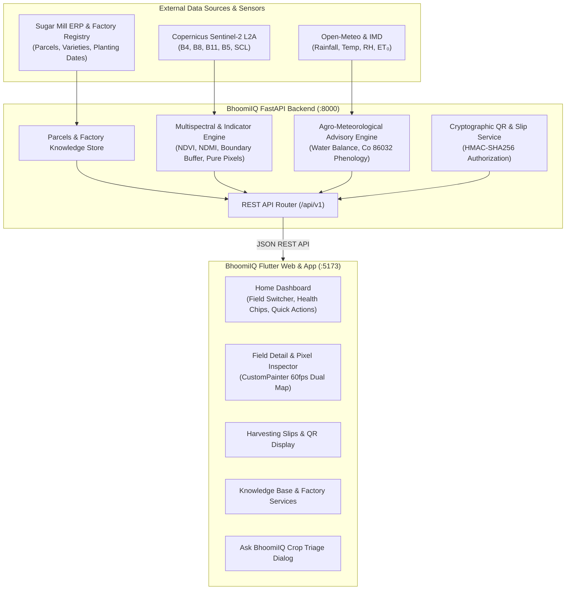

# BhoomiIQ (भूमि IQ) — Satellite Crop Intelligence & Farmer Advisory System

[](https://fastapi.tiangolo.com)
[](https://flutter.dev)
[](https://www.python.org/)
[](https://dataspace.copernicus.eu/)
[](#)

**BhoomiIQ** is a standalone, scientifically grounded Earth Observation and agricultural intelligence platform designed for sugarcane farmers and cooperative sugar factories (such as Rajarambapu Patil Sahakari Sakhar Karkhana Ltd. — RBPSSK). 

It bridges multispectral satellite remote sensing (**Copernicus Sentinel-2 Level-2A**), agro-meteorology (**Open-Meteo & IMD**), parcel-level sugarcane phenology (Co 86032, Phule 265), and mill operations (cryptographically verified harvesting slips, factory subsidy schemes, and drone service bookings).

---

## 📌 Table of Contents

- [Core Scientific Philosophy & Differentiators](#-core-scientific-philosophy--differentiators)
- [System Architecture](#-system-architecture)
- [Key Features](#-key-features)
- [Project Directory Structure](#-project-directory-structure)
- [Quick Start Guide](#-quick-start-guide)
  - [1-Click Fullstack Startup](#1-one-click-fullstack-startup-recommended)
  - [Manual Backend Setup](#2-manual-backend-setup)
  - [Manual Frontend Setup](#3-manual-frontend-setup)
- [Configuration & Environment Variables](#-configuration--environment-variables)
- [API Reference](#-api-reference)
- [Testing & Quality Assurance](#-testing--quality-assurance)
- [Legal & Agronomic Disclaimers](#-legal--agronomic-disclaimers)

---

## 🔬 Core Scientific Philosophy & Differentiators

Unlike generic agricultural dashboards that present visual aerial photos or uncalibrated color maps, BhoomiIQ enforces strict remote sensing and agronomic standards:

1. **Visual Basemap vs. Scientific Reflectance**:
   - High-resolution visual satellite photography (Google Satellite / Esri World Imagery) is explicitly labeled as a **Visual Basemap** for orientation.
   - Spectral analytics are independently computed from calibrated **Copernicus Sentinel-2 Level-2A Bottom-Of-Atmosphere (BOA) Surface Reflectance** bands ($B4, B8, B11, B5$) with Scene Classification Layer (SCL) cloud and cloud-shadow filtering.

2. **Canopy Moisture (NDMI) $\neq$ Root-Zone Soil Moisture**:
   - The moisture indicator is explicitly labeled as **Canopy Moisture Signal (NDMI)** ($[B8 - B11] / [B8 + B11]$), measuring internal mesophyll hydration and water stress.
   - It is transparently paired with 7-day/14-day cumulative rainfall and Penman-Monteith reference evapotranspiration ($ET_0$) water balance rather than falsely claiming satellite radar penetration into deep root-zone soil.

3. **Small Parcel Resolution & Boundary Erosion**:
   - Sugarcane holdings in western Maharashtra typically range from 0.59 to 1.08 acres. Under 10m/20m Sentinel-2 ground sampling distance, small plots produce only 6 to 24 raw pixels.
   - BhoomiIQ applies an inner boundary erosion buffer (5m) to exclude edge pixels contaminated by irrigation canals, cart tracks, and tree shadows.
   - The UI surfaces a **Parcel Pixel Resolution Rating** (pure usable pixel ratio) and automatically recommends factory drone multispectral surveys when pixel counts drop below high-confidence thresholds.

4. **Legally Distinct Harvesting Authorization**:
   - Digital sugarcane harvesting slips issued via the platform are cryptographically signed using **HMAC-SHA256** and verified via dynamic QR codes.
   - The system clearly differentiates between **Harvesting Authorization** (mill scheduling permission) and **Weighbridge Receipts** (gross/tare/net weight payable receipts).

---

## 🏛 System Architecture



---

## ✨ Key Features

| Module | Features & Capabilities |
| :--- | :--- |
| **🏠 Home Dashboard** | Farmer greeting, field selector, quick health chips (*Growing well*, *Check*, *Inspect first*), interactive visual preview, quick actions (*My Slips*, *Farm Visits*, *Farm Store*, *Drone Services*), and Annadata AI query box. |
| **🗺️ Interactive Field Details** | Dual spectral tabs (**Crop Growth [NDVI]** vs. **Moisture Signs [NDMI]**), pixel tap/hover inspector with raw reflectance metrics, satellite scene ID and acquisition freshness badge, **Parcel Resolution Alert** (pure usable pixel ratio), expandable historical revisit timeline, and dynamic **"YOUR NEXT STEP"** field-level differential diagnosis. |
| **📜 Sugarcane Harvesting Slips** | Mill harvesting permits detailing farmer name, survey number, variety, planting date, estimated tonnage, and cutting schedule; complete with official mill crest and **dynamic HMAC-SHA256 verifiable QR code**. |
| **📚 Learn & Factory Services** | Stage-categorized sugarcane agronomy guides (trash mulching, seed treatment with Bavistin, ratoon management), deduplicated factory subsidy schemes (drip irrigation 10% rebate, subsurface drainage loans), and facility booking (soil testing lab, drone multispectral surveys). |
| **🤖 "Ask BhoomiIQ" AI Assistant** | Evidence-based interactive symptom triage for common cane distress (early shoot borer, internode borer, nitrogen chlorosis, fungal red rot) providing severity levels, immediate cultural practices, and recommended verifications. |
| **⚡ High-Performance Rendering** | Zero heavy native map SDK overhead — utilizes Flutter's optimized `CustomPainter` to render aerial basemaps, parcel vector boundaries, and 10m/20m scientific pixel heatmaps at 60 FPS. |
| **📶 Offline-First Resilience** | Client automatically falls back to cached factory parcel models if the backend is temporarily unreachable, preventing blank screens or app crashes. |

---

## 📂 Project Directory Structure

```text
BhoomiIQ/
├── README.md                                    # Root repository documentation (this file)
├── BhoomiIQ_satellite_crop_intelligence_plan.md # Architectural plan and design specification
├── start_bhoomiiq.bat                           # 1-Click launcher for Windows (Backend + Frontend)
│
├── backend/                                     # Python FastAPI Backend
│   ├── .env                                     # Environment configuration file
│   ├── .env.example                             # Template configuration file
│   ├── requirements.txt                         # Python dependencies
│   ├── run_server.py                            # Standalone server starter
│   ├── test_api.py                              # Comprehensive API test suite
│   ├── app/
│   │   ├── config.py                            # Pydantic v2 Settings parser
│   │   ├── main.py                              # FastAPI application entrypoint & CORS
│   │   ├── api/v1/endpoints.py                  # Full REST API routes
│   │   ├── models/schemas.py                    # Pydantic data schemas
│   │   └── services/                            # Multispectral, weather, and QR slip engines
│   └── data/                                    # Local parcel datasets & factory knowledge base
│
└── frontend/                                    # Flutter Multiplatform Client
    ├── pubspec.yaml                             # Flutter package definition & dependencies
    ├── build/web/                               # Pre-compiled high-performance Web distribution
    └── lib/
        ├── main.dart                            # Flutter app entrypoint & routing
        ├── theme/app_theme.dart                 # Color palette & typography
        ├── models/                              # Dart domain models
        ├── services/api_service.dart            # Backend client with offline fallback
        ├── screens/
        │   ├── main_shell_screen.dart           # Navigation bar shell
        │   ├── home_dashboard_screen.dart       # Home overview & quick actions
        │   ├── field_detail_screen.dart         # Spectral inspector & CustomPainter map
        │   ├── slips_screen.dart                # Harvesting slips & QR rendering
        │   └── learn_screen.dart                # Agronomy guides & mill schemes
        └── widgets/                             # Custom visual painter & UI components
```

---

## 🚀 Quick Start Guide

### 1. One-Click Fullstack Startup (Recommended)

On Windows, double-click or run:
```powershell
.\start_bhoomiiq.bat
```
This script will:
1. Launch the **Python FastAPI Backend** on `http://127.0.0.1:8000`.
2. Launch the **Flutter Web Frontend** on `http://127.0.0.1:5173`.
3. Open your default web browser directly to the BhoomiIQ dashboard.

---

### 2. Manual Backend Setup

**Prerequisites**: Python 3.10+ installed.

```powershell
cd backend

# Create and activate virtual environment (optional but recommended)
python -m venv venv
.\venv\Scripts\activate

# Install dependencies
pip install -r requirements.txt

# Start the server
python run_server.py
```
* Backend API root: [http://localhost:8000](http://localhost:8000)
* Interactive Swagger Docs: [http://localhost:8000/docs](http://localhost:8000/docs)
* ReDoc Specification: [http://localhost:8000/redoc](http://localhost:8000/redoc)

---

### 3. Manual Frontend Setup

**Option A — Serve the Pre-Compiled Web Build (Fastest)**
```powershell
cd frontend
python -m http.server 5173 --directory build\web
```
Access in browser: `http://localhost:5173`

**Option B — Run with Flutter SDK (Hot Reload & Development)**
```powershell
cd frontend

# Run in Google Chrome
flutter run -d chrome

# Run as Windows Desktop Application
flutter run -d windows
```

---

## ⚙️ Configuration & Environment Variables

All backend parameters are loaded from [`backend/.env`](file:///d:/Attend/field_staff_attendance_new/BhoomiIQ/backend/.env) via `pydantic-settings`:

| Key | Description | Example / Default |
| :--- | :--- | :--- |
| `APP_ENV` | Application environment mode | `development` |
| `HOST` | Bind host address | `0.0.0.0` |
| `PORT` | Bind port number | `8000` |
| `DEBUG` | Enable debug mode and hot reloading | `true` |
| `CORS_ORIGINS` | Allowed frontend origins | `http://localhost:5173,http://localhost:3000` |
| `COPERNICUS_STAC_URL` | Copernicus Data Space STAC API | `https://stac.dataspace.copernicus.eu/v1` |
| `PLANETARY_COMPUTER_STAC_URL` | Microsoft Planetary Computer STAC | `https://planetarycomputer.microsoft.com/api/stac/v1` |
| `OPEN_METEO_FORECAST_URL` | Open-Meteo Agro-Weather endpoint | `https://api.open-meteo.com/v1/forecast` |
| `FACTORY_NAME` | Attached cooperative sugar mill | `Rajarambapu Patil Sahakari Sakhar Karkhana Ltd.` |
| `FACTORY_CODE` | Mill identifier code | `RBPSSK` |
| `SECRET_KEY` | HMAC-SHA256 signing key for slips | *(Cryptographically secure random key)* |

---

## 📡 API Reference

| Method | Endpoint | Description |
| :--- | :--- | :--- |
| `GET` | `/health` | Health check and active configuration metadata |
| `GET` | `/api/v1/fields` | List all registered farmer parcels with metadata |
| `GET` | `/api/v1/fields/{id}/analysis` | Full multispectral analysis (NDVI, NDMI, boundary buffer, advisory) |
| `GET` | `/api/v1/satellite/scenes/{id}` | Historical satellite acquisition timeline and cloud cover % |
| `GET` | `/api/v1/satellite/pixels/{id}` | Pixel-by-pixel surface reflectance values and classification |
| `GET` | `/api/v1/weather/{id}` | Real-time agro-meteorological metrics & $ET_0$ water balance |
| `GET` | `/api/v1/slips` | List issued sugarcane harvesting authorization slips |
| `POST` | `/api/v1/slips/verify-qr` | Cryptographic verification of slip QR code signatures |
| `GET` | `/api/v1/learn/guides` | Stage-categorized agronomic guides |
| `GET` | `/api/v1/learn/schemes` | Deduplicated factory subsidy schemes |
| `GET` | `/api/v1/learn/facilities` | Deduplicated factory services (Soil testing, drone survey) |
| `POST` | `/api/v1/ai/photo-triage` | Evidence-based crop pest and symptom triage |

---

## 🧪 Testing & Quality Assurance

### Run Backend Test Suite
The backend includes automated integration tests verifying API schemas, CORS headers, multispectral calculations, and HMAC QR signatures:
```powershell
cd backend
python test_api.py
```

### Run Frontend Test Suite
```powershell
cd frontend
flutter test
```

---

## ⚖️ Legal & Agronomic Disclaimers

1. **Spectral Indicator Limitations**:
   Multispectral indices (NDVI, NDMI, NDRE) provide canopy-level optical signals. They do not substitute for in-person agronomist soil profiling or leaf tissue laboratory testing.
2. **Soil Moisture vs. Canopy Moisture**:
   NDMI measures liquid water in crop vegetation canopies. Surface and root-zone soil water estimates require integration with IMD rainfall records, tensiometer sensors, or calibrated hydrological balance models.
3. **Harvesting Slip Authorization**:
   Harvesting slips generated by BhoomiIQ represent operational authorization to cut and transport cane according to mill schedule. They do not constitute a weighbridge delivery receipt or payment voucher. Final cane settlement is based strictly on physical weighbridge scale readings at the factory gate.
